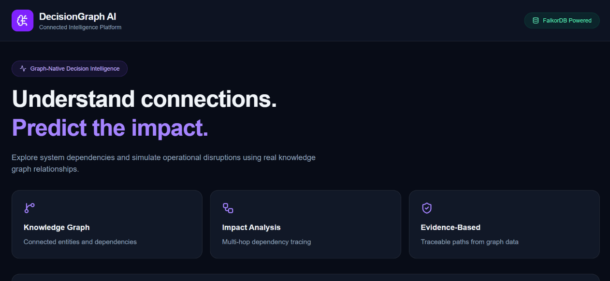
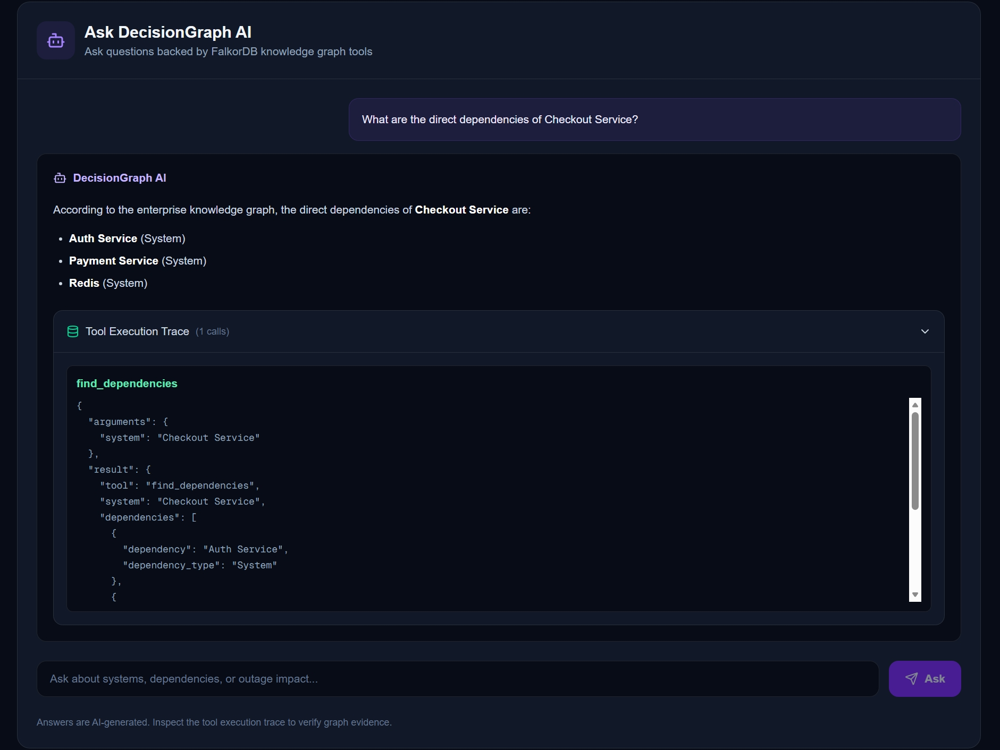
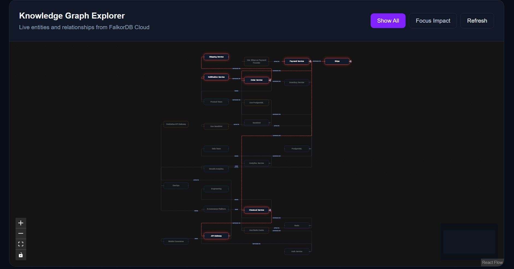
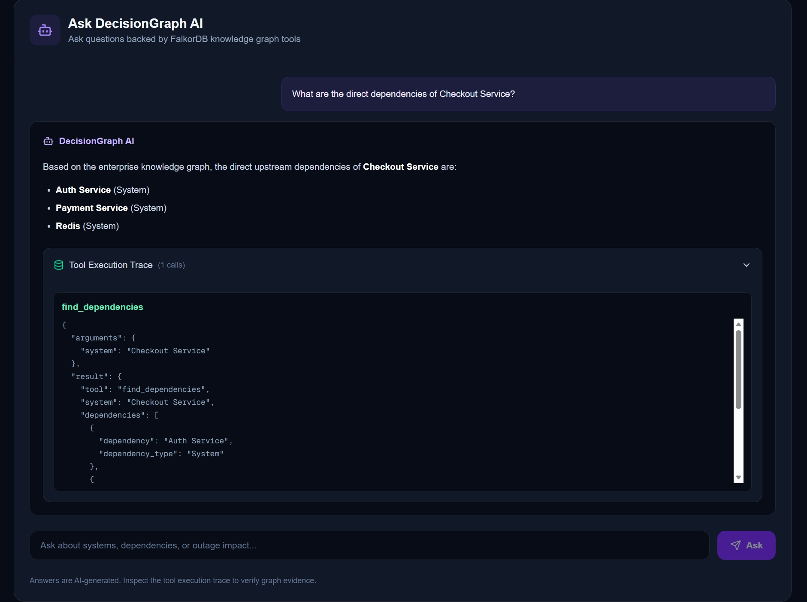

# DecisionGraph AI

### Understand connections. Predict the impact.

**DecisionGraph AI** is a graph-powered operational intelligence application that helps teams understand system dependencies, simulate service outages, and generate evidence-based impact analysis using AI.

Built with **FalkorDB Cloud**, **Google Gemini**, and **Next.js**.

## Live Demo

**Try DecisionGraph AI:**
https://decisiongraph-ai-black.vercel.app

No installation or local server is required to explore the deployed application.

## Product Screenshots

### 1. DecisionGraph AI Dashboard



The operational intelligence dashboard powered by FalkorDB.

### 2. What-If Impact Simulator



Simulate a Stripe outage and trace its impact across six downstream systems.

### 3. Knowledge Graph Explorer



Explore live graph relationships and highlighted outage propagation paths.

### 4. AI Assistant with Tool Execution Trace



Ask natural-language questions and inspect the FalkorDB-backed tool execution trace.

## The Problem

Modern applications depend on interconnected services, databases, APIs, and external providers.

When one component fails, identifying downstream consequences can be difficult.

Traditional dashboards show individual service health, but often fail to explain how failures propagate through complex dependencies.

## Our Solution

DecisionGraph AI combines a graph database with AI-powered analysis to help users:

- Explore relationships between infrastructure components.
- Simulate outages and identify affected systems.
- Trace dependency paths through the architecture.
- Generate mitigation recommendations.
- Ask natural-language questions about system dependencies.
- Inspect AI tool execution traces for transparency.

## Why FalkorDB?

System dependencies are naturally represented as a graph.

DecisionGraph AI uses FalkorDB Cloud to store infrastructure entities and their relationships.

For example:

```text
Checkout Service
    |
    v
Payment Service
    |
    v
Stripe

```

This graph structure enables dependency traversal and impact analysis.

## Key Features

### Knowledge Graph Explorer
Explore infrastructure entities and their relationships through an interactive graph visualization.

The demonstration dataset contains 25 nodes and 26 relationships.

### What-If Impact Simulator
Select a system to simulate an outage and discover downstream dependencies.

For example, a Stripe outage affects six systems:
- Payment Service
- Checkout Service
- Order Service
- Shipping Service
- Notification Service
- API Gateway

The simulator displays dependency paths and traversal depths.

### AI Impact Analyst
Google Gemini analyzes graph-derived impact information and generates operational recommendations.

### Ask DecisionGraph AI
Ask natural-language questions about the infrastructure.

Example question:

"What are the direct dependencies of Checkout Service?"

Gemini calls FalkorDB-backed tools and displays an execution trace showing the information retrieved.

## Architecture

```text
User
 |
 v
Next.js Application (Vercel)
 |
 +-- Knowledge Graph Explorer --> FalkorDB Cloud
 |
 +-- Impact Simulator ---------> FalkorDB Cloud
 |
 +-- AI Impact Analyst --------> FalkorDB + Gemini
 |
 +-- Ask DecisionGraph AI
       |
       v
   Gemini Function Calling
       |
       v
   Graph Query Tools
       |
       v
   FalkorDB Cloud
```

## Technology Stack

| Layer | Technology |
|---|---|
| Frontend | Next.js, React, TypeScript, Tailwind CSS |
| Graph Database | FalkorDB Cloud |
| AI | Google Gemini |
| AI Integration | Gemini Function Calling |
| Rate Limiting | Upstash Redis |
| Hosting | Vercel |

## Graph-Powered AI Tools

DecisionGraph AI provides three tools for Gemini:

- `list_systems`
- `analyze_impact`
- `find_dependencies`

These tools retrieve graph information to support AI-generated answers.


## Graph Data Model and Cypher

DecisionGraph AI stores infrastructure components as `System`
nodes connected by directed `DEPENDS_ON` relationships.

For example, Checkout Service depends on Payment Service,
which in turn depends on Stripe.

### Impact Analysis

The following query traces systems affected by an outage:

    MATCH p=(affected:System)-[:DEPENDS_ON*1..8]->
    (provider:System {name: $system})
    RETURN affected.name AS affected_system,
           length(p) AS dependency_depth,
           [n IN nodes(p) | n.name] AS dependency_path
    ORDER BY dependency_depth
    LIMIT 100

The application counts unique affected system names among
the returned paths. The 100-path limit bounds the demo query.

### Graph-Grounded AI Tools

- `list_systems`: retrieves available systems.
- `analyze_impact`: traces affected systems and paths.
- `find_dependencies`: retrieves direct dependencies.

All three tools execute Cypher queries against FalkorDB.
Gemini can use their results to generate graph-grounded answers,
and the interface displays tool execution traces.

## Hackathon Track

**Agents That Act on Connected Data**

## AI Assistance Disclosure

AI-assisted tools were used for coding, debugging, and documentation.
The developer directed the product design, reviewed implementation,
and tested the application. Gemini also powers runtime AI analysis.

## API Endpoints

| Endpoint | Purpose |
|---|---|
| `/api/health` | Database connectivity |
| `/api/graph` | Knowledge graph visualization |
| `/api/impact?system=Stripe` | Outage impact simulation |
| `/api/agent` | AI impact analysis |
| `/api/ask` | Natural-language graph questions |

## Reliability and Security

The prototype includes input validation, API rate limiting, graph caching, in-flight query deduplication, and server-side credential management.

These measures improve demo reliability but do not represent a complete enterprise security audit.

## Run Locally

Install dependencies:

```bash
npm install
```

Configure the required FalkorDB, Gemini, and Upstash environment variables in `.env.local`.

Never commit credentials to GitHub.

Start the application:

```bash
npm run dev
```

Open http://localhost:3000.

## Live Deployment

https://decisiongraph-ai-black.vercel.app

The deployed application runs on Vercel and uses cloud-hosted services. It does not require the developer's laptop to remain online.

## Project Status

DecisionGraph AI is a functional hackathon prototype demonstrating graph-based dependency analysis and AI-assisted incident reasoning.

The current dataset is intended for demonstration. Large-scale enterprise performance has not yet been benchmarked.

## Source Code

https://github.com/zzzyyyddd/decisiongraph-ai
